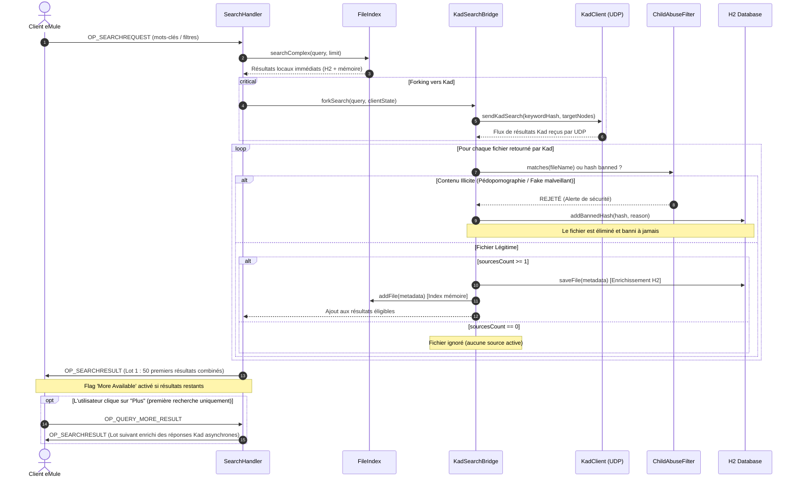
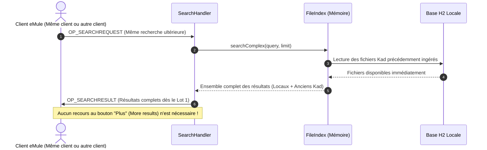

# Spécification Fonctionnelle Détaillée (SFD) — Version 1.2
## Module d'Intégration Kademlia, Recherche Forkée et Filtrage Protecteur

---

### Informations sur le Document

| Propriété | Valeur |
| :--- | :--- |
| **Projet** | JEmuleServer |
| **Document** | Spécification Fonctionnelle Détaillée (SFD) |
| **Version cible** | 1.2 |
| **Statut** | Validé pour implémentation |
| **Date** | 17 octobre 2026 |
| **Référence** | `SFD_1.2.md` |
| **Système cible** | Java 21 LTS (Virtual Threads), Base H2, Protocole ed2k / Kad2 |

---

## 1. Contexte et Enjeux

### 1.1 Existant (Version 1.1)
Dans sa version 1.1, [JEmuleServer](file:///home/dagga/IdeaProjects/JEmuleServer/README.md) propose une implémentation moderne, performante et sécurisée d'un serveur eDonkey2000 (ed2k) écrit en Java 21. Ses fonctionnalités phares incluent :
- Une architecture asynchrone reposant sur les **Virtual Threads** (Project Loom).
- La persistance des fichiers indexés dans une base relationnelle embarquée **H2** ([`DatabaseManager`](file:///home/dagga/IdeaProjects/JEmuleServer/src/main/java/org/jemule/core/DatabaseManager.java)).
- Un filtre strict, inviolable et non désactivable contre les contenus pédopornographiques ([`ChildAbuseFilter`](file:///home/dagga/IdeaProjects/JEmuleServer/src/main/java/org/jemule/security/ChildAbuseFilter.java)).
- Une recherche booléenne avancée couvrant l'ensemble des fichiers connus de la base de données.

### 1.2 Problématique
Le réseau eMule historique est scindé en deux topologies complémentaires :
1. **Le réseau centralisé ED2K** : les clients se connectent à un serveur (comme JEmuleServer), publient leur catalogue de fichiers (`OP_OFFERFILES`) et effectuent des requêtes de recherche locale (`OP_SEARCHREQUEST`). Le serveur ne connaît que les fichiers déclarés par ses clients connectés ou mémorisés dans sa base locale.
2. **Le réseau décentralisé DHT Kademlia (Kad)** : réseau pair-à-pair pur (UDP sans serveur central) reliant des millions de clients. Bien que très riche en sources et contenus, le réseau Kad est totalement **non modéré**, **dépourvu de tout contrôle éthique** et fréquemment pollué par des contenus illégaux, notamment pédopornographiques.

Aujourd'hui, un utilisateur recherchant sur JEmuleServer est limité au catalogue connu du serveur. S'il souhaite chercher sur Kad, il doit le faire directement depuis son client eMule, s'exposant ainsi sans aucune protection aux contenus illicites circulant sur la DHT.

### 1.3 Objectifs de la Version 1.2
La version 1.2 introduit une innovation architecturale majeure visant à réunir le meilleur des deux mondes :
1. **Bootstrap Kad automatique via les clients du serveur** : JEmuleServer intègre un nœud/client Kademlia autonome capable de s'amorcer (bootstrap) directement auprès des clients eMule connectés au serveur qui participent déjà au réseau Kad.
2. **Recherche transparente forkée (dérivée)** : lorsqu'un client eMule effectue une recherche locale standard (`OP_SEARCHREQUEST`) auprès de JEmuleServer, le serveur exécute sa recherche locale habituelle tout en déclenchant en parallèle ("fork") une recherche distribuée sur le réseau Kad mondial.
3. **Alimentation dynamique du référentiel H2 et effet de préchauffage (Cache-Warming)** : les fichiers découverts sur Kad disposant d'au moins une source active (`sources >= 1`) sont automatiquement indexés et persistés dans la base de données H2 de JEmuleServer. **Bénéfice utilisateur direct** : lors de toute recherche ultérieure portant sur les mêmes termes (par le même client ou un autre client du serveur), ces résultats font désormais partie intégrante du référentiel local H2. Ils sont ainsi retournés **instantanément dès le premier lot de résultats** (`OP_SEARCHRESULT`), évitant à l'utilisateur d'avoir à attendre le réseau Kad ou à cliquer sur l'option « Plus de résultats » (*More results*).
4. **Filtrage protecteur "Secure by Design"** : tous les résultats provenant du réseau Kad traversent obligatoirement le [`ChildAbuseFilter`](file:///home/dagga/IdeaProjects/JEmuleServer/src/main/java/org/jemule/security/ChildAbuseFilter.java) du serveur avant d'être présentés au client ou enregistrés en base. Tout fichier illicite est **immédiatement rejeté**, son empreinte cryptographique (hash) est bannie à perpétuité dans la table `banned_hashes`, et l'utilisateur est totalement préservé de l'exposition à ce contenu.

---

## 2. Périmètre du Lot (Scope)

### 2.1 En Périmètre (In-Scope)
- **Module KadClient embarqué** :
  - Gestion du socket UDP Kad (protocole `0x3A` Kademlia 2.0).
  - Gestion de l'identité du serveur dans la DHT (Node ID 128 bits persistant).
  - Table de routage Kademlia (K-Buckets de taille $k=20$, rafraîchissement périodique).
- **Auto-Bootstrapping sur les clients connectés** :
  - Détection automatique des clients connectés au serveur supportant Kad.
  - Envoi de paquets de bootstrap UDP (`KADEMLIA2_BOOTSTRAP_REQ` / `KADEMLIA2_HELLO_REQ`) vers les adresses IP et ports Kad/UDP des clients.
- **Passerelle de recherche (Kad Search Bridge)** :
  - Détection et parsing des requêtes `OP_SEARCHREQUEST` entrantes.
  - Conversion des termes de recherche en requêtes Kad 2.0 (`KADEMLIA2_SEARCH_KEY_REQ`).
  - Corrélation asynchrone des réponses Kad avec la session de recherche du client.
- **Filtrage et Sécurisation obligatoire** :
  - Contrôle systématique des hashes et des noms de fichiers Kad par [`ChildAbuseFilter`](file:///home/dagga/IdeaProjects/JEmuleServer/src/main/java/org/jemule/security/ChildAbuseFilter.java).
  - Éviction des fichiers suspects via [`FakeFileDetector`](file:///home/dagga/IdeaProjects/JEmuleServer/src/main/java/org/jemule/security/FakeFileDetector.java).
  - Banning automatique et persistant des hashes incriminés dans `banned_hashes`.
- **Enrichissement de la base H2 et accélération des recherches futures** :
  - Sauvegarde en base H2 des métadonnées de fichiers Kad validés ayant `sources >= 1`.
  - Intégration en temps réel dans l'index inversé en mémoire [`FileIndex`](file:///home/dagga/IdeaProjects/JEmuleServer/src/main/java/org/jemule/core/FileIndex.java).
  - **Élimination du besoin de « More results » aux requêtes suivantes** : les fichiers ingérés en base H2 sont immédiatement accessibles localement. Toute recherche ultérieure sur ces mots-clés délivre directement ces résultats dans le premier lot de réponses sans latence et sans que l'utilisateur n'ait à utiliser l'option « Plus de résultats » (*More results*).
- **Restitution transparente au client** :
  - Fusion et déduplication des résultats locaux et des résultats Kad validés.
  - Distribution par lots (paquets `OP_SEARCHRESULT`, 50 résultats par lot).
  - Gestion transparente du bouton "Plus de résultats" (`OP_QUERY_MORE_RESULT`) lors de la première découverte Kad (phase asynchrone).
- **Configuration et Supervision** :
  - Paramètres dédiés dans `server.properties`.
  - Commandes d'administration CLI / TCP (`kad status`, `kad contacts`, etc.).
  - Statistiques d'événements (`EventManager`, `EventStatistics`).

### 2.2 Hors Périmètre (Out-of-Scope)
- Téléchargement du contenu des fichiers : JEmuleServer reste un serveur d'indexation/annuaire et ne télécharge ni ne relaye les flux de données de fichiers.
- Publication proactive des fichiers locaux vers Kad : le serveur n'annonce pas ses propres fichiers sur Kad (il agit en client consommateur de la DHT pour ne pas altérer le routage Kad sans être source directe).
- Interface graphique utilisateur (GUI) : la configuration et l'administration s'opèrent exclusivement par fichiers et CLI.

---

## 3. Architecture Fonctionnelle et Technique

### 3.1 Vue d'ensemble des Composants

```mermaid
flowchart TD
    subgraph Client eMule
        CL[Client eMule / aMule]
    end

    subgraph JEmuleServer Core
        TCP[TCP Handler / ClientHandler]
        SH[SearchHandler]
        FI[FileIndex]
        DB[(H2 Database)]
        CAF[ChildAbuseFilter & FakeDetector]
    end

    subgraph Module Kademlia Embarqué
        KB[KadSearchBridge]
        KC[KadClient Engine]
        RT[Kad Routing Table / K-Buckets]
        UDP[UDP Socket Handler Kad2 0x3A]
    end

    subgraph Réseau Décentralisé
        KAD_NODES[Pairs Kademlia distants]
        CONN_CLIENTS[Clients eMule connectés au serveur]
    end

    CL -->|1. OP_SEARCHREQUEST TCP| TCP
    TCP --> SH
    SH -->|2. Recherche locale| FI
    FI <--> DB
    
    SH -->|3. Fork asynchrone| KB
    KB -->|4. Search Key Req| KC
    KC <-->|Lookup UDP| UDP
    UDP <-->|Requêtes / Réponses Kad| KAD_NODES
    
    CONN_CLIENTS -.->|Bootstrap UDP| KC
    KC --> RT

    UDP -->|5. Résultats Kad bruts| KC
    KC -->|6. Fichiers découverts| KB
    KB -->|7. Contrôle strict anti-pedo| CAF
    
    CAF -- Si illicite -->|Bannissement hash| DB
    CAF -- Si valide & sources >= 1 -->|8. Ingestion & Persistance| DB
    CAF -- Si valide & sources >= 1 -->|9. Indexation mémoire| FI
    
    KB -->|10. Résultats filtrés| SH
    SH -->|11. OP_SEARCHRESULT unifié| TCP
    TCP -->|12. Réponses transparentes| CL
```

### 3.2 Cycle de Vie et Déroulement d'une Recherche Forkée



#### 3.2.1 Cinématique d'une Recherche Ultérieure (Effet Persistant H2 — Zéro « More »)

Dès lors que la recherche initiale a peuplé la base H2 et le `FileIndex`, toute recherche suivante (par le même client ou un autre client) bénéficie de l'intégration locale immédiate :



---

## 4. Description Détaillée des Exigences Fonctionnelles

### 4.1 Module Client Kademlia Embarqué (EF-KAD-01)

| Identifiant | EF-KAD-01 |
| :--- | :--- |
| **Intitulé** | Moteur Kademlia autonome et gestion de la table de routage |
| **Description** | Le serveur instancie un nœud Kademlia complet conforme à la spécification eMule Kad2 (`protocol 0x3A`). |

- **Identité du Nœud (Node ID)** :
  - JEmuleServer génère un identifiant Kademlia 128 bits pseudo-aléatoire unique lors de son premier démarrage.
  - Cet identifiant est persisté dans la base H2 (table `stats` sous la clé `kad_node_id`) afin de conserver la réputation du nœud à travers les redémarrages.
- **Port d'écoute UDP dédié** :
  - Le client Kad utilise un port UDP dédié configurable via `kadPort` (par défaut : `port TCP + 11`, ex: `4672`).
  - Le socket prend en charge la réception de paquets UDP multiplexés sans bloquer le serveur grâce à un Virtual Thread dédié.
- **Table de Routage (K-Buckets)** :
  - Implémentation d'une structure en arbre binaire de K-Buckets de profondeur 128 avec métrique de distance XOR.
  - Chaque seau (bucket) contient au maximum $k = 20$ contacts actifs.
  - Gestion des règles de remplacement : les nœuds anciens et stables sont privilégiés ; les nœuds sans réponse après 3 tentatives consécutives sont expulsés.
  - Tâche de fond périodique (toutes les 60 secondes) de rafraîchissement des buckets les moins sollicités.

### 4.2 Auto-Bootstrapping via les Clients Connectés (EF-KAD-02)

| Identifiant | EF-KAD-02 |
| :--- | :--- |
| **Intitulé** | Découverte et amorçage Kad sur les clients connectés au serveur |
| **Description** | Le serveur tire profit de la population de ses clients connectés pour peupler rapidement sa table de routage Kad sans dépendre d'un fichier `nodes.dat` statique tiers. |

- **Détection des pairs éligibles** :
  - Lors du handshake de connexion TCP ([`LoginHandler`](file:///home/dagga/IdeaProjects/JEmuleServer/src/main/java/org/jemule/network/handler/LoginHandler.java)), le serveur identifie les clients disposant d'une adresse IP publique valide et d'un HighID.
  - Si le client annonce un port UDP Kad (notamment via les tags étendus `CT_EMULE_VERSION`, informations d'obfuscation UDP ou port Kad conventionnel), ce client est ajouté à la file d'attente d'amorçage (`BootstrapQueue`).
- **Procédure d'amorçage** :
  - Le serveur envoie un paquet `KADEMLIA2_BOOTSTRAP_REQ` ou `KADEMLIA2_HELLO_REQ` en UDP vers le client connecté.
  - À la réception du paquet `KADEMLIA2_BOOTSTRAP_RES`, le serveur extrait la liste des contacts Kad renvoyés (jusqu'à 20 nœuds voisins) et les insère dans ses K-Buckets.
  - Une fois 50 contacts actifs atteints, la phase d'amorçage est considérée comme réussie et le statut Kad bascule à `CONNECTED`.
- **Tolérance aux pannes** :
  - Si le nombre de clients connectés est faible (< 5), le module peut optionnellement recharger les derniers nœuds valides sauvegardés en base H2 ou charger un fichier local `nodes.dat` s'il est présent.

### 4.3 Forking Transparent des Recherches (EF-KAD-03)

| Identifiant | EF-KAD-03 |
| :--- | :--- |
| **Intitulé** | Dédoublement transparent des recherches locales vers le réseau Kad |
| **Description** | Chaque requête de recherche transmise par un client au serveur est exécutée localement et simultanément projetée sur la DHT Kademlia. |

- **Interception dans [`SearchHandler`](file:///home/dagga/IdeaProjects/JEmuleServer/src/main/java/org/jemule/network/handler/SearchHandler.java)** :
  - Dès réception d'un paquet `OP_SEARCHREQUEST` (0x16), le serveur lance la recherche locale standard dans [`FileIndex`](file:///home/dagga/IdeaProjects/JEmuleServer/src/main/java/org/jemule/core/FileIndex.java).
  - Parallèlement, si l'option `kadForkSearchEnabled` est active (par défaut : `true`), la requête est transmise au composant `KadSearchBridge`.
- **Conversion de la requête en recherche Kad** :
  - La recherche Kademlia s'effectue par hash de mot-clé (MD4 du premier terme textuel significatif normalisé, longueur >= 3 caractères).
  - Le nœud Kad serveur identifie dans sa table de routage les $\alpha = 3$ nœuds les plus proches du hash du mot-clé et émet des paquets `KADEMLIA2_SEARCH_KEY_REQ`.
- **Gestion temporelle et asynchrone** :
  - La recherche locale répond immédiatement sans attendre le réseau Kad afin de garantir une réactivité maximale pour le client.
  - Un délai paramétrable de collecte Kad (ex: `kadSearchTimeoutSeconds = 4`) permet d'agréger les premières réponses Kad avant de clore le premier lot ou de garnir le lot de réserve (`pendingSearchResults`).

### 4.4 Filtrage Protecteur Strict "Secure by Construction" (EF-KAD-04)

| Identifiant | EF-KAD-04 |
| :--- | :--- |
| **Intitulé** | Épuration impérative des résultats Kad par le filtre anti-pédopornographique |
| **Description** | Le serveur applique son filtre éthique et légal sur 100% des résultats provenant de Kad avant tout affichage ou mémorisation. |

- **Principe d'inviolabilité** :
  - Le réseau Kad n'étant pas modéré, des contenus pédo-criminels y circulent. Le passage par JEmuleServer constitue un **bouclier de protection** pour l'utilisateur.
- **Règles de filtrage systématique** :
  1. **Contrôle de bannissement préalable** : le hash MD4 du fichier Kad est confronté au cache mémoire `abuseBannedHashes` et à la table SQL `banned_hashes`. S'il est présent, il est **rejeté sans délai**.
  2. **Analyse lexicale et heuristique** : le nom du fichier est soumis à [`ChildAbuseFilter.matches(fileName)`](file:///home/dagga/IdeaProjects/JEmuleServer/src/main/java/org/jemule/security/ChildAbuseFilter.java).
     - Tout terme interdit ou toute combinaison d'un marqueur d'âge mineur ($\le 17$ ans) et d'un vocable à caractère sexuel déclenche le rejet.
  3. **Bannissement automatique persistant** :
     - En cas de détection positive, le hash est immédiatement inséré dans la table `banned_hashes` avec la raison `Child abuse material: <termes détectés>` et horodaté.
     - Un événement de sécurité est tracé dans les logs applicatifs (`WARN [SECURITY] Child abuse file from Kad banned: hash=... name=...`).
  4. **Détection de faux fichiers / spam** :
     - Les fichiers répondant aux heuristiques de faux fichiers ([`FakeFileDetector`](file:///home/dagga/IdeaProjects/JEmuleServer/src/main/java/org/jemule/security/FakeFileDetector.java), ex: extensions doubles `.avi.exe`, spam publicitaire) sont rejetés.
- **Résultat** :
  - **Aucun fichier non conforme n'est transmis au client**, ni enregistré dans l'index ou dans la base H2.

### 4.5 Ingestion et Enrichissement du Référentiel H2 (EF-KAD-05)

| Identifiant | EF-KAD-05 |
| :--- | :--- |
| **Intitulé** | Persistance conditionnelle des fichiers Kad dans le référentiel H2 |
| **Description** | Les fichiers découverts sur Kad, sains et disposant d'au moins 1 source active, sont enregistrés de façon pérenne dans la base H2 du serveur. |

- **Condition stricte de disponibilité (Sources $\ge 1$)** :
  - Les annonces Kad contiennent le nombre de sources recensées par la DHT pour le fichier (`FT_SOURCES`).
  - **Règle métier** : seuls les fichiers ayant au minimum **une source active** (`sourcesCount >= 1`) sont éligibles à l'ingestion dans le référentiel H2.
  - Les fichiers "fantômes" (0 source) ne sont ni stockés en base, ni présentés dans les résultats Kad prioritaires.
- **Persistance en base de données** :
  - Appel de [`DatabaseManager.saveFile(FileMetadata)`](file:///home/dagga/IdeaProjects/JEmuleServer/src/main/java/org/jemule/core/DatabaseManager.java).
  - Écriture dans la table `files` : `hash`, `name`, `size`, `type`.
  - Écriture dans la table `file_tags` : tag du nombre de sources (`FT_SOURCES`), nom d'origine, tag d'origine réseau (`NETWORK_KAD`).
  - L'opération s'effectue sous le contrôle du **Circuit Breaker** (Resilience4j) afin qu'une charge importante d'écritures Kad ne dégrade pas les performances transactionnelles du serveur.
- **Indexation en mémoire temps réel** :
  - Le fichier est inséré dans le [`FileIndex`](file:///home/dagga/IdeaProjects/JEmuleServer/src/main/java/org/jemule/core/FileIndex.java) (index inversé par tokens lexicaux).
  - Le fichier devient immédiatement interrogeable par tous les autres clients connectés au serveur lors de leurs futures recherches.

#### 4.5.1 Effet d'Enrichissement Cumulatif et Élimination de « More Results » pour les Recherches Ultérieures
L'intégration directe en base H2 confère au serveur une propriété d'apprentissage continu :
1. **Phase de découverte initiale (Cold Search)** :
   - Lorsqu'une recherche est exécutée pour la première fois sur un terme rare ou absent de la base locale, le dédoublement Kad découvre les fichiers, les filtre et les enregistre en base H2.
   - Durant cette première occurrence, les réponses Kad arrivant au fil de l'eau peuvent nécessiter l'activation du drapeau `moreAvailable` et l'usage ponctuel de `OP_QUERY_MORE_RESULT` ("Plus") par le client pour récupérer l'excédent de résultats.
2. **Recherches ultérieures (Warm Search)** :
   - Lors de la prochaine recherche portant sur ces mêmes termes — qu'elle soit initiée par le **même utilisateur** ou par **n'importe quel autre utilisateur connecté** au serveur — les fichiers Kad sont **déjà indexés dans la base H2 locale**.
   - Le moteur [`FileIndex.searchComplex`](file:///home/dagga/IdeaProjects/JEmuleServer/src/main/java/org/jemule/core/FileIndex.java#L269-L277) extrait directement ces fichiers de la base H2 dès la première milliseconde.
   - Ils sont inclus immédiatement dans le **premier lot de 50 résultats** transmis via `OP_SEARCHRESULT`.
   - **Conséquence directe** : l'utilisateur dispose instantanément de l'ensemble des résultats consolidés et **n'a plus besoin d'utiliser l'option « Plus de résultats » (*More results*)**.

### 4.6 Restitution Transparente et Pagination (EF-KAD-06)

| Identifiant | EF-KAD-06 |
| :--- | :--- |
| **Intitulé** | Restitution unifiée et gestion fluide de la pagination des résultats |
| **Description** | Le client reçoit les résultats sans savoir s'ils proviennent du serveur ou de Kad, au format natif ed2k. |

- **Fusion et déduplication** :
  - Les résultats locaux et les résultats Kad filtrés sont agrégés au sein d'une collection ordonnée par pertinence et nombre de sources.
  - En cas de collision de hash entre un fichier local et un fichier Kad, l'entrée locale est conservée et son compteur de sources est mis à jour si Kad rapporte davantage de sources.
- **Distribution par paquets `OP_SEARCHRESULT`** :
  - Conforme au protocole standard eMule : envoi d'un premier lot de 50 résultats maximum (`BATCH_SIZE = 50`).
  - Si des résultats supplémentaires existent (notamment lors d'une première découverte Kad asynchrone), le drapeau `moreAvailable` (octet `0x01` en queue de paquet) est activé.
  - Cet octet débloque le bouton "Plus" ("More") dans l'interface du client eMule / aMule de l'utilisateur uniquement lorsque cela est nécessaire.
- **Traitement de `OP_QUERY_MORE_RESULT` (0x21)** :
  - Lorsque le client clique sur "Plus", il émet `OP_QUERY_MORE_RESULT`.
  - [`SearchHandler.handleQueryMoreResult`](file:///home/dagga/IdeaProjects/JEmuleServer/src/main/java/org/jemule/network/handler/SearchHandler.java#L50-L64) dépile le lot suivant depuis `pendingSearchResults`.
  - *Rappel clé* : dès lors que la recherche a été exécutée une fois et persistée en H2, les recherches ultérieures retournent directement les résultats enrichis sans imposer cette étape supplémentaire.

---

## 5. Données et Évolution du Schéma H2

### 5.1 Schéma Relationnel H2 Existant et Ajustements

Le schéma H2 actuel défini dans [`DatabaseManager.initSchema`](file:///home/dagga/IdeaProjects/JEmuleServer/src/main/java/org/jemule/core/DatabaseManager.java#L74-L115) est étendu de manière rétrocompatible :

```sql
-- Table existante des fichiers (inchangée dans sa structure principale)
CREATE TABLE IF NOT EXISTS files (
    hash VARCHAR(32) PRIMARY KEY,
    name VARCHAR(1024) NOT NULL,
    size BIGINT NOT NULL,
    type VARCHAR(255),
    source_origin VARCHAR(16) DEFAULT 'ED2K', -- Nouvelle colonne : 'ED2K', 'KAD', 'HYBRID'
    first_seen TIMESTAMP DEFAULT CURRENT_TIMESTAMP,
    last_seen TIMESTAMP DEFAULT CURRENT_TIMESTAMP
);

-- Table des tags (inchangée)
CREATE TABLE IF NOT EXISTS file_tags (
    file_hash VARCHAR(32),
    tag_type TINYINT,
    tag_name VARCHAR(255),
    tag_value_str TEXT,
    tag_value_blob BLOB,
    FOREIGN KEY (file_hash) REFERENCES files(hash) ON DELETE CASCADE
);

-- Table des hashes bannis (inchangée, réutilisée pour le filtre anti-pedo Kad)
CREATE TABLE IF NOT EXISTS banned_hashes (
    hash VARCHAR(32) PRIMARY KEY,
    reason VARCHAR(255),
    added_at TIMESTAMP DEFAULT CURRENT_TIMESTAMP
);

-- Table des statistiques et persistance de la DHT
CREATE TABLE IF NOT EXISTS stats (
    stat_key VARCHAR(255) PRIMARY KEY,
    stat_value BIGINT
);

-- Nouvelle table : Cache des nœuds Kademlia vérifiés pour bootstrap rapide
CREATE TABLE IF NOT EXISTS kad_nodes (
    node_id VARCHAR(32) PRIMARY KEY,
    ip_address VARCHAR(45) NOT NULL,
    udp_port INT NOT NULL,
    kad_version TINYINT DEFAULT 2,
    last_seen TIMESTAMP DEFAULT CURRENT_TIMESTAMP
);
```

---

## 6. Configuration et Administration

### 6.1 Nouvelles Options dans `server.properties`

Les paramètres suivants sont ajoutés au fichier [`server.properties`](file:///home/dagga/IdeaProjects/JEmuleServer/server.properties) :

```properties
# ===================================================================
# Kademlia Client & Search Forking Configuration (Version 1.2)
# ===================================================================

# Active le client Kademlia embarqué (default: true)
kadEnabled=true

# Port d'écoute UDP pour le protocole Kad2 (default: 4672)
kadPort=4672

# Autorise l'auto-bootstrap via les clients eMule connectés (default: true)
kadBootstrapFromClients=true

# Nombre maximal de contacts dans la table de routage (default: 500)
kadMaxRoutingContacts=500

# Active le dédoublement systématique des recherches vers Kad (default: true)
kadForkSearchEnabled=true

# Durée maximale d'attente d'une recherche Kad en secondes (default: 4)
kadSearchTimeoutSeconds=4

# Ingestion automatique des fichiers découverts sur Kad dans la base H2 (default: true)
kadAutoIngestToH2=true

# Nombre minimum de sources requises pour qu'un fichier Kad soit ingéré (default: 1)
# Note : 1 est la valeur recommandée. Les fichiers à 0 source ne sont jamais enregistrés.
kadMinSourcesForIngest=1
```

### 6.2 Commandes d'Administration (Console CLI et Port Admin)

Le module [`AdminInterface`](file:///home/dagga/IdeaProjects/JEmuleServer/src/main/java/org/jemule/network/AdminInterface.java) s'enrichit de commandes dédiées :

- `kad status` : Affiche l'état du nœud Kad (ID du nœud, port UDP, statut connexion `DISCONNECTED` / `CONNECTING` / `CONNECTED`, nombre de contacts vivants dans les K-Buckets).
- `kad contacts` : Liste les 20 contacts Kad les plus récents (NodeID, IP, port, version, temps de réponse).
- `kad bootstrap <ip> <port>` : Force un envoi manuel de paquet d'amorçage vers un nœud spécifique.
- `kad stats` : Métriques détaillées (recherches forkées, résultats reçus, fichiers ingérés en base H2, fichiers bloqués par le filtre anti-pedo).

---

## 7. Exigences Non-Fonctionnelles (NFR)

### 7.1 Performance et Concurrence (Virtual Threads)
- **Modèle de Threads** : l'ensemble des requêtes Kad entrantes et sortantes UDP est géré via `Executors.newVirtualThreadPerTaskExecutor()`. Aucune opération réseau Kad ne bloque les threads de traitement des connexions TCP client ed2k.
- **Empreinte mémoire** : la table de routage Kademlia est bornée à 500 contacts actifs par défaut, représentant une empreinte mémoire inférieure à 2 Mo.
- **Latence ressentie par le client** : la recherche locale ed2k n'attend pas la fin de la recherche Kad. Le premier paquet de résultats est envoyé sans surcoût de latence perçu ; l'apport de Kad enrichit les résultats au fil de l'eau.

### 7.2 Sécurité et Éthique
- **Protection absolue contre les contenus illicites** : le [`ChildAbuseFilter`](file:///home/dagga/IdeaProjects/JEmuleServer/src/main/java/org/jemule/security/ChildAbuseFilter.java) est injecté comme passerelle obligatoire infranchissable dans le flux de retour de `KadSearchBridge`.
- **Anonymisation et RGPD** : les requêtes Kad émises par JEmuleServer utilisent l'identité du serveur (NodeID serveur) et ne révèlent jamais l'adresse IP du client émetteur de la recherche ed2k aux nœuds tiers du réseau Kad.

### 7.3 Résilience
- **Résistance à la déconnexion** : en cas d'indisponibilité ou d'isolement temporaire du réseau Kad, le serveur continue d'assurer 100% de ses fonctionnalités de recherche ed2k locale sans lever d'erreur bloquante.
- **Protection de la base H2** : toute insertion de fichier Kad est couverte par le Circuit Breaker de [`DatabaseManager`](file:///home/dagga/IdeaProjects/JEmuleServer/src/main/java/org/jemule/core/DatabaseManager.java) pour préserver la base de données en cas de pic de résultats.

---

## 8. Plan de Validation et Critères d'Acceptation

### 8.1 Matrice de Traçabilité des Tests

| Réf. Test | Fonctionnalité ciblée | Description du Test | Résultat Attendu |
| :--- | :--- | :--- | :--- |
| **TC-01** | Auto-Bootstrap Kad | Connexion d'un client eMule avec port UDP valide. | JEmuleServer envoie un `KADEMLIA2_BOOTSTRAP_REQ` et insère le pair dans ses K-Buckets dès réception du `BOOTSTRAP_RES`. |
| **TC-02** | Recherche Locale Pure | Recherche d'un terme existant uniquement dans la base locale H2. | Résultats locaux retournés immédiatement via `OP_SEARCHRESULT`. |
| **TC-03** | Recherche Forkée Kad | Recherche d'un terme inexistant en local mais présent sur Kad. | La recherche locale retourne 0 résultat initial, la recherche Kad retourne les fichiers qui sont présentés dans les résultats. |
| **TC-04** | Ingestion H2 conditionnelle | Réception d'un résultat Kad avec `sources = 0` vs `sources >= 1`. | Le fichier avec `sources = 0` est ignoré. Le fichier avec `sources >= 1` est écrit dans `files` et `file_tags`. |
| **TC-05** | Filtrage Anti-Pedo Kad | Réception simulée depuis Kad d'un fichier dont le nom viole les mots-clés interdits. | Le fichier est **rejeté**, non envoyé au client, et son hash est persisté dans `banned_hashes`. |
| **TC-06** | Pagination `QUERY_MORE` | Recherche retournant > 50 résultats combinés (local + Kad). | Premier paquet de 50 avec flag `more=1`. Réception du paquet `OP_QUERY_MORE_RESULT` et envoi du lot suivant. |
| **TC-07** | Indisponibilité Kad | Simulation du réseau Kad indisponible (socket fermé ou timeout). | La recherche du client se déroule normalement sur l'index local sans plantage ni blocage. |
| **TC-08** | Recherche ultérieure (Zero More) | Exécution d'une 2nde recherche sur des termes préalablement découverts sur Kad. | Les résultats sont servis immédiatement depuis H2 dès le premier paquet `OP_SEARCHRESULT` sans nécessiter d'appel à `OP_QUERY_MORE_RESULT`. |

### 8.2 Critères d'Acceptation de la Release 1.2
1. 100% des tests unitaires et d'intégration existants et nouveaux passent avec succès (`./gradlew test`).
2. Aucun fichier identifié comme pédopornographique par le filtre ne peut franchir le serveur vers un client lors d'une recherche forkée.
3. Les fichiers sains découverts sur Kad avec $\ge 1$ source sont consultables dans la table `files` de la base H2 après exécution de la recherche.
4. Les performances de traitement des clients TCP ed2k ne subissent aucune régression mesurable (> 95% de requêtes locales traitées en < 10 ms).

---

## 9. Plan d'Implémentation et Suivi des Sous-Lots

Pour garantir une livraison maîtrisée, incrémentale et vérifiée par des tests automatisés sans régression, l'implémentation est découpée en **5 sous-lots opérationnels** :

### Tableau de Suivi d'Avancement

| Sous-Lot | Intitulé & Périmètre | Statut | Livrables / Commits |
| :--- | :--- | :---: | :--- |
| **Sous-Lot 1** | **Socle Kademlia, Distance XOR & Codecs UDP** | ✅ **Terminé** | [`60a3545`](file:///home/dagga/IdeaProjects/JEmuleServer/src/main/java/org/jemule/kad/KadId.java), [`5adf06f`](file:///home/dagga/IdeaProjects/JEmuleServer/src/main/java/org/jemule/kad/KadRoutingTable.java), [`5777d09`](file:///home/dagga/IdeaProjects/JEmuleServer/src/main/java/org/jemule/kad/KadPacket.java) |
| **Sous-Lot 2** | **Service Réseau UDP & Auto-Bootstrap via Clients** | ⏳ **En cours** | `KadUdpService`, `BootstrapManager`, hooks `LoginHandler` |
| **Sous-Lot 3** | **Passerelle de Recherche Forkée & Filtrage Protecteur** | 📋 **Planifié** | `KadSearchBridge`, branchement `ChildAbuseFilter`, `banned_hashes` |
| **Sous-Lot 4** | **Ingestion H2 Conditionnelle & Restitution Unifiée** | 📋 **Planifié** | Sauvegarde H2 (`sources >= 1`), déduplication `OP_SEARCHRESULT` |
| **Sous-Lot 5** | **Configuration, Administration CLI & Recette Complète** | 📋 **Planifié** | `server.properties`, CLI admin (`kad status`), validation globale |

---

### Détail des Tâches par Sous-Lot

#### Sous-Lot 1 : Socle Kademlia & Table de Routage (Statut : ✅ Terminé)
- [x] **Point 1.1 — Identifiant 128 bits & Hachage MD4** *(Commit `60a3545`)* :
  - [`MD4`](file:///home/dagga/IdeaProjects/JEmuleServer/src/main/java/org/jemule/kad/MD4.java) : implémentation autonome RFC 1320 pour les hashes Kad et mots-clés.
  - [`KadId`](file:///home/dagga/IdeaProjects/JEmuleServer/src/main/java/org/jemule/kad/KadId.java) : métrique XOR, calculs de préfixe, comparaisons et conversion hexadécimale.
  - [`KadIdTest`](file:///home/dagga/IdeaProjects/JEmuleServer/src/test/java/org/jemule/kad/KadIdTest.java) : tests de conformité des vecteurs de test MD4 et calculs de distance.
- [x] **Point 1.2 — Table de Routage & K-Buckets** *(Commit `5adf06f`)* :
  - [`KadContact`](file:///home/dagga/IdeaProjects/JEmuleServer/src/main/java/org/jemule/kad/KadContact.java) : structure d'un pair Kad avec gestion du cycle de vie et liveness.
  - [`KadBucket`](file:///home/dagga/IdeaProjects/JEmuleServer/src/main/java/org/jemule/kad/KadBucket.java) : gestionnaire de seau ($k=20$) avec file de remplacement et promotion.
  - [`KadRoutingTable`](file:///home/dagga/IdeaProjects/JEmuleServer/src/main/java/org/jemule/kad/KadRoutingTable.java) : table à 128 buckets, recherche de proximité `findClosest` et cibles de rafraîchissement.
  - [`KadRoutingTableTest`](file:///home/dagga/IdeaProjects/JEmuleServer/src/test/java/org/jemule/kad/KadRoutingTableTest.java) : validation des capacités, évictions et lookups.
- [x] **Point 1.3 — Sérialisation des Paquets Kad2 UDP** *(Commit `5777d09`)* :
  - [`KadOpCode`](file:///home/dagga/IdeaProjects/JEmuleServer/src/main/java/org/jemule/kad/KadOpCode.java) : opcodes protocolaires Kad2 (`0x3A`).
  - [`KadPacket`](file:///home/dagga/IdeaProjects/JEmuleServer/src/main/java/org/jemule/kad/KadPacket.java) : encodeurs/décodeurs `BOOTSTRAP`, `HELLO`, `REQ/RES`, `SEARCH_KEY_REQ/RES`.
  - [`KadPacketTest`](file:///home/dagga/IdeaProjects/JEmuleServer/src/test/java/org/jemule/kad/KadPacketTest.java) : tests de sérialisation et d'intégrité des messages binaires.

#### Sous-Lot 2 : Service Réseau UDP & Auto-Bootstrap (Statut : ⏳ En cours)
- [ ] **Point 2.1 — Moteur Réseau UDP Asynchrone** :
  - Socket UDP dédié sur Virtual Threads pour la réception et l'émission multiplexée de paquets Kad2.
  - Boucle d'écoute et dispatcheur de paquets entrants (`BOOTSTRAP_RES`, `HELLO_RES`, `RES`, `SEARCH_RES`).
- [ ] **Point 2.2 — Auto-Bootstrap via les Clients Connectés** :
  - Capture des clients éligibles (HighID, port UDP) lors du handshake dans [`LoginHandler`](file:///home/dagga/IdeaProjects/JEmuleServer/src/main/java/org/jemule/network/handler/LoginHandler.java).
  - Émission de `BOOTSTRAP_REQ` et ingestion automatique des contacts renvoyés dans [`KadRoutingTable`](file:///home/dagga/IdeaProjects/JEmuleServer/src/main/java/org/jemule/kad/KadRoutingTable.java).
- [ ] **Point 2.3 — Maintien et Rafraîchissement Périodique** :
  - Tâche d'arrière-plan pour rafraîchir les K-Buckets inactifs et vérifier la liveness des pairs.

#### Sous-Lot 3 : Passerelle de Recherche Forkée & Sécurité (Statut : 📋 Planifié)
- [ ] **Point 3.1 — Dédoublement Asynchrone des Recherches** :
  - Interception dans [`SearchHandler`](file:///home/dagga/IdeaProjects/JEmuleServer/src/main/java/org/jemule/network/handler/SearchHandler.java) et transmission au composant `KadSearchBridge`.
  - Émission de `SEARCH_KEY_REQ` vers les nœuds les plus proches du hash du mot-clé.
- [ ] **Point 3.2 — Filtrage Protecteur Strict par Construction** :
  - Soumission systématique de chaque résultat Kad à [`ChildAbuseFilter`](file:///home/dagga/IdeaProjects/JEmuleServer/src/main/java/org/jemule/security/ChildAbuseFilter.java) et [`FakeFileDetector`](file:///home/dagga/IdeaProjects/JEmuleServer/src/main/java/org/jemule/security/FakeFileDetector.java).
- [ ] **Point 3.3 — Bannissement Automatique des Contenus Illicites** :
  - Inscription immédiate et persistance des hashes incriminés dans `banned_hashes` de la base H2.

#### Sous-Lot 4 : Ingestion H2 Conditionnelle & Restitution Unifiée (Statut : 📋 Planifié)
- [ ] **Point 4.1 — Ingestion Conditionnelle en Base H2** :
  - Contrôle strict `sources >= 1` et persistance dans [`DatabaseManager`](file:///home/dagga/IdeaProjects/JEmuleServer/src/main/java/org/jemule/core/DatabaseManager.java).
  - Indexation immédiate en mémoire dans [`FileIndex`](file:///home/dagga/IdeaProjects/JEmuleServer/src/main/java/org/jemule/core/FileIndex.java).
- [ ] **Point 4.2 — Fusion et Distribution `OP_SEARCHRESULT`** :
  - Restitution par lots de 50 résultats et prise en charge de `OP_QUERY_MORE_RESULT`.
- [ ] **Point 4.3 — Restitution Directe aux Recherches Suivantes** :
  - Garantie de service direct depuis H2 sans recours à « More results » pour les requêtes ultérieures.

#### Sous-Lot 5 : Configuration, Administration CLI & Recette Complète (Statut : 📋 Planifié)
- [ ] **Point 5.1 — Paramétrage Externe** :
  - Clés de configuration dans [`server.properties`](file:///home/dagga/IdeaProjects/JEmuleServer/server.properties) et mapping dans [`ServerConfig`](file:///home/dagga/IdeaProjects/JEmuleServer/src/main/java/org/jemule/config/ServerConfig.java).
- [ ] **Point 5.2 — Commandes d'Administration** :
  - Ajout des commandes `kad status`, `kad contacts`, `kad stats` dans [`AdminInterface`](file:///home/dagga/IdeaProjects/JEmuleServer/src/main/java/org/jemule/network/AdminInterface.java).
- [ ] **Point 5.3 — Validation Finale & Recette** :
  - Exécution complète de la suite de tests (`./gradlew test`) et validation des critères d'acceptation.

