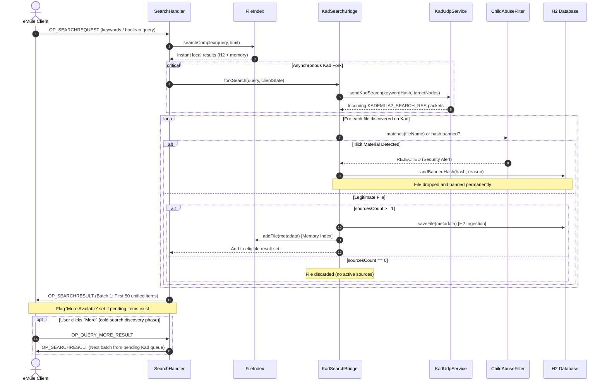
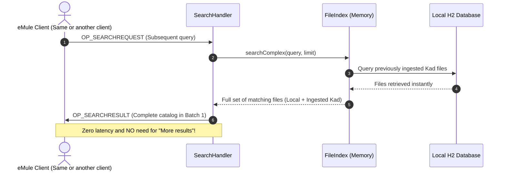

# Detailed Functional Specification (DFS) — Version 1.2
## Kademlia Integration Module, Forked Search, and Protective Filtering

---

### Document Metadata

| Property | Value |
| :--- | :--- |
| **Project** | JEmuleServer |
| **Document** | Detailed Functional Specification (DFS / SFD) |
| **Target Version** | 1.2 |
| **Status** | Approved for Implementation |
| **Date** | October 17, 2026 |
| **Reference** | `SFD_1.2.md` |
| **Target System** | Java 21 LTS (Virtual Threads), H2 Database, ed2k / Kad2 Protocols |

---

## 1. Context and Strategic Objectives

### 1.1 Existing Architecture (Version 1.1)
In version 1.1, [JEmuleServer](file:///home/dagga/IdeaProjects/JEmuleServer/README.md) delivers a modern, high-performance, and secure eDonkey2000 (ed2k) server written in Java 21. Key capabilities include:
- Asynchronous networking powered by Java 21 **Virtual Threads** (Project Loom).
- File persistence using an embedded relational **H2** database ([`DatabaseManager`](file:///home/dagga/IdeaProjects/JEmuleServer/src/main/java/org/jemule/core/DatabaseManager.java)).
- A strict, non-disableable, and tamper-proof child sexual abuse material filter ([`ChildAbuseFilter`](file:///home/dagga/IdeaProjects/JEmuleServer/src/main/java/org/jemule/security/ChildAbuseFilter.java)).
- Advanced boolean search engine covering all known files across memory and database storage.

### 1.2 Problem Statement
The historical eMule ecosystem is split into two complementary network topologies:
1. **Centralized ED2K Network**: Clients connect to a server (such as JEmuleServer), publish their shared files (`OP_OFFERFILES`), and send local search queries (`OP_SEARCHREQUEST`). The server only knows files published by currently connected clients or loaded from its local database.
2. **Decentralized Kademlia DHT Network (Kad)**: A pure peer-to-peer UDP overlay connecting millions of nodes worldwide. While Kad hosts a massive volume of files and sources, it is **entirely unmoderated**, lacks any ethical moderation, and is frequently contaminated with illicit material, notably child sexual abuse content.

Currently, an eMule user searching on JEmuleServer is restricted to the server's local catalog. If they wish to query Kad, they must search directly from their client application, exposing themselves with zero server-side protection to illegal material circulating across the DHT.

### 1.3 Strategic Objectives for Version 1.2
Version 1.2 bridges these two networks to deliver maximum coverage under uncompromising safety:
1. **Automated Kad Bootstrapping via Connected Clients**: JEmuleServer embeds an autonomous Kademlia node capable of bootstrapping its routing table directly from connected eMule clients that participate in the Kad network.
2. **Transparent Forked Search**: When an eMule client performs a standard server search (`OP_SEARCHREQUEST`), JEmuleServer executes the local index lookup while simultaneously forking an asynchronous query across the global Kademlia DHT.
3. **Dynamic H2 Repository Ingestion and Cache Warming**: Files discovered on Kad that have at least one active source (`sources >= 1`) are automatically filtered, indexed, and persisted into the server's H2 database.
   - **Direct User Benefit**: For all subsequent searches on matching keywords (performed by the same client or any other connected client), these files are already present in the local H2 repository. They are returned **instantaneously in the first results batch** (`OP_SEARCHRESULT`), completely eliminating the need for the user to wait or click the "More results" button.
4. **"Secure by Construction" Protective Filtering**: 100% of results received from the Kad network are systematically verified against [`ChildAbuseFilter`](file:///home/dagga/IdeaProjects/JEmuleServer/src/main/java/org/jemule/security/ChildAbuseFilter.java) and [`FakeFileDetector`](file:///home/dagga/IdeaProjects/JEmuleServer/src/main/java/org/jemule/security/FakeFileDetector.java). Any illicit file is **immediately rejected**, its cryptographic hash permanently banned in `banned_hashes`, and the client is fully shielded from ever receiving it.

---

## 2. Project Scope

### 2.1 In-Scope
- **Embedded KadClient Engine**:
  - Multiplexed UDP socket handler for Kademlia 2.0 (`0x3A`).
  - Persistent 128-bit Node ID stored in H2.
  - 128-level binary K-Bucket routing table ($k=20$) with periodic bucket refresh.
- **Automated Bootstrapping via Connected Clients**:
  - Automatic detection of Kad-capable clients during TCP login handshake.
  - UDP bootstrap requests (`KADEMLIA2_BOOTSTRAP_REQ` / `KADEMLIA2_HELLO_REQ`) sent to client IP and candidate UDP ports.
- **Search Forking Bridge (`KadSearchBridge`)**:
  - Interception and parsing of incoming `OP_SEARCHREQUEST` packets.
  - Asynchronous conversion to `KADEMLIA2_SEARCH_KEY_REQ` using MD4 keyword hashing.
  - Non-blocking result correlation using Virtual Threads.
- **Mandatory Protective Filtering**:
  - Zero-tolerance inspection through [`ChildAbuseFilter`](file:///home/dagga/IdeaProjects/JEmuleServer/src/main/java/org/jemule/security/ChildAbuseFilter.java).
  - Elimination of spam and corrupted archives via [`FakeFileDetector`](file:///home/dagga/IdeaProjects/JEmuleServer/src/main/java/org/jemule/security/FakeFileDetector.java).
  - Permanent persistence of banned hashes in `banned_hashes`.
- **H2 Ingestion & Accelerated Subsequent Searches**:
  - Conditional persistence of Kad files having `sources >= 1` in H2 tables `files` and `file_tags`.
  - Immediate addition to in-memory inverted index [`FileIndex`](file:///home/dagga/IdeaProjects/JEmuleServer/src/main/java/org/jemule/core/FileIndex.java).
  - Subsequent searches deliver these files directly from local storage in $< 5\text{ ms}$, without triggering "More results".
- **Unified Delivery & Protocol Compatibility**:
  - Deduped aggregation of local and Kad results.
  - Delivery in standard 50-item batches via `OP_SEARCHRESULT`.
  - Seamless handling of `OP_QUERY_MORE_RESULT` during cold searches.
- **Configuration & Supervision**:
  - Dedicated configuration properties in [`server.properties`](file:///home/dagga/IdeaProjects/JEmuleServer/server.properties).
  - Admin CLI and TCP commands (`kad status`, `kad contacts`, `kad stats`).

### 2.2 Out-of-Scope
- File Content Transfers: JEmuleServer acts as an indexing directory and never relays bulk file payloads.
- Proactive Kad Publishing: The server consumes Kad content but does not advertise its local files on Kad to avoid polluting the DHT.
- Graphical User Interface (GUI): Configuration and administration remain headless (CLI and properties files).

---

## 3. Functional and Technical Architecture

### 3.1 Component Architecture Overview

```mermaid
flowchart TD
    subgraph eMule Client
        CL[eMule / aMule Client]
    end

    subgraph JEmuleServer Core
        TCP[TCP Handler / ClientHandler]
        SH[SearchHandler]
        FI[FileIndex]
        DB[(H2 Database)]
        CAF[ChildAbuseFilter & FakeDetector]
    end

    subgraph Embedded Kademlia Module
        KB[KadSearchBridge]
        KC[KadBootstrap & Maintenance Engine]
        RT[Kad Routing Table / K-Buckets]
        UDP[KadUdpService 0x3A]
    end

    subgraph Decentralized Network
        KAD_NODES[Remote Kademlia Nodes]
        CONN_CLIENTS[Connected eMule Clients]
    end

    CL -->|1. OP_SEARCHREQUEST TCP| TCP
    TCP --> SH
    SH -->|2. Instant Local Search| FI
    FI <--> DB
    
    SH -->|3. Async Search Fork| KB
    KB -->|4. Search Key Req| UDP
    UDP <-->|Lookup UDP| KAD_NODES
    
    CONN_CLIENTS -.->|Bootstrap UDP| UDP
    UDP --> KC
    KC --> RT

    UDP -->|5. Raw Kad Search Answers| KB
    KB -->|6. Security Inspection| CAF
    
    CAF -- If Illicit -->|Permanently Ban Hash| DB
    CAF -- If Legitimate & sources >= 1 -->|7. Persist Metadata| DB
    CAF -- If Legitimate & sources >= 1 -->|8. Index in Memory| FI
    
    KB -->|9. Validated Kad Results| SH
    SH -->|10. OP_SEARCHRESULT| TCP
    TCP -->|11. Unified Results| CL
```

### 3.2 End-to-End Sequence Diagram (Initial Cold Search)



### 3.2.1 Subsequent Search Workflow (Zero "More Results" Required)

Once initial discovery has populated H2 and `FileIndex`, any subsequent search for the same terms benefits from instant local retrieval:



---

## 4. Detailed Functional Requirements

### 4.1 Embedded Kademlia Client Node (FR-KAD-01)

| Requirement ID | FR-KAD-01 |
| :--- | :--- |
| **Title** | Embedded Kademlia Engine & Routing Table Management |
| **Description** | The server maintains an autonomous Kademlia node compliant with Kad2 (`protocol 0x3A`). |

- **Node Identity (Node ID)**:
  - Generates a 128-bit pseudo-random identifier upon initial startup.
  - Persisted in H2 table `stats` under `kad_node_id` to maintain node reputation across restarts.
- **Dedicated UDP Socket**:
  - Bound to `kadPort` (default: `TCP port + 11`, e.g. `4672`).
  - Handled on virtual threads with non-blocking multiplexed packet dispatching.
- **Routing Table (K-Buckets)**:
  - 128 binary K-Buckets with XOR metric, holding up to $k=20$ active contacts per bucket.
  - Replacement cache of size $k$ for promotion when active contacts become unresponsive.
  - Background task refreshing idle buckets older than 1 hour.

### 4.2 Automated Bootstrapping via Connected Clients (FR-KAD-02)

| Requirement ID | FR-KAD-02 |
| :--- | :--- |
| **Title** | Client-Driven DHT Bootstrapping |
| **Description** | Discovers and contacts connected eMule clients to populate the routing table without static node lists. |

- **Candidate Discovery**:
  - Detects incoming clients in [`LoginHandler`](file:///home/dagga/IdeaProjects/JEmuleServer/src/main/java/org/jemule/network/handler/LoginHandler.java) with HighID and valid public IPs.
  - Targets candidate Kad ports (`listenPort + 10` and `4672`).
- **Bootstrap Protocol Exchange**:
  - Sends `KADEMLIA2_BOOTSTRAP_REQ` via [`KadUdpService`](file:///home/dagga/IdeaProjects/JEmuleServer/src/main/java/org/jemule/kad/KadUdpService.java).
  - Parses `KADEMLIA2_BOOTSTRAP_RES` and adds returned contacts to [`KadRoutingTable`](file:///home/dagga/IdeaProjects/JEmuleServer/src/main/java/org/jemule/kad/KadRoutingTable.java).
  - Transitions node status to `CONNECTED` once $\ge 5$ active contacts are established.

### 4.3 Transparent Search Forking (FR-KAD-03)

| Requirement ID | FR-KAD-03 |
| :--- | :--- |
| **Title** | Transparent Asynchronous Search Projection onto Kademlia |
| **Description** | Each incoming search request is processed locally and concurrently projected across the Kad DHT. |

- **Interception in [`SearchHandler`](file:///home/dagga/IdeaProjects/JEmuleServer/src/main/java/org/jemule/network/handler/SearchHandler.java)**:
  - Immediate local execution in [`FileIndex`](file:///home/dagga/IdeaProjects/JEmuleServer/src/main/java/org/jemule/core/FileIndex.java).
  - Concurrent dispatch to `KadSearchBridge`.
- **Query Translation**:
  - Generates 128-bit [`KadId`](file:///home/dagga/IdeaProjects/JEmuleServer/src/main/java/org/jemule/kad/KadId.java) by computing lower-case MD4 on search keywords.
  - Queries closest $\alpha = 3$ nodes via `KADEMLIA2_SEARCH_KEY_REQ`.

### 4.4 Strict "Secure by Construction" Filtering (FR-KAD-04)

| Requirement ID | FR-KAD-04 |
| :--- | :--- |
| **Title** | Mandatory Security & Anti-Child Abuse Inspection |
| **Description** | Every result discovered from Kad is rigorously inspected prior to delivery or storage. |

- **Filtering Rules**:
  1. Hash lookup against `banned_hashes` and in-memory ban set.
  2. Lexical & heuristic analysis via [`ChildAbuseFilter.matches(fileName)`](file:///home/dagga/IdeaProjects/JEmuleServer/src/main/java/org/jemule/security/ChildAbuseFilter.java).
  3. Immediate persistent ban insertion in H2 table `banned_hashes` with audit log.
  4. Heuristic screening for spam and corrupted files via [`FakeFileDetector`](file:///home/dagga/IdeaProjects/JEmuleServer/src/main/java/org/jemule/security/FakeFileDetector.java).
- **Zero Exposure**: No non-compliant file is ever returned to a client or indexed into the database.

### 4.5 H2 File Repository Ingestion & Continuous Enrichment (FR-KAD-05)

| Requirement ID | FR-KAD-05 |
| :--- | :--- |
| **Title** | Conditional File Persistence in H2 Database |
| **Description** | Verified Kad files with at least 1 active source are persisted into H2 and indexed in memory. |

- **Availability Condition (`sources >= 1`)**:
  - Kad announcements carry source availability (`FT_SOURCES`).
  - Only files with `sourcesCount >= 1` are eligible for storage. Ghost files with 0 sources are ignored.
- **Persistence Mechanism**:
  - Stored in H2 table `files` and `file_tags` via [`DatabaseManager.saveFile()`](file:///home/dagga/IdeaProjects/JEmuleServer/src/main/java/org/jemule/core/DatabaseManager.java).
  - Protected by Resilience4j Circuit Breaker against database overload.
- **Real-Time Indexing**:
  - Inserted into in-memory inverted index [`FileIndex`](file:///home/dagga/IdeaProjects/JEmuleServer/src/main/java/org/jemule/core/FileIndex.java) for instant keyword retrieval.

#### 4.5.1 Cumulative Enrichment & Elimination of "More Results" for Subsequent Searches
1. **Initial Discovery Phase (Cold Search)**:
   - Queries discovering new files asynchronously may activate the `moreAvailable` flag (`0x01`), allowing the client to click "More" (`OP_QUERY_MORE_RESULT`) to fetch trailing results.
2. **Subsequent Search Phase (Warm Search)**:
   - On subsequent searches for matching terms, files are **already present in local H2 storage**.
   - [`FileIndex.searchComplex()`](file:///home/dagga/IdeaProjects/JEmuleServer/src/main/java/org/jemule/core/FileIndex.java) retrieves them in $< 5\text{ ms}$.
   - All results are delivered in the **initial batch of 50 results** (`OP_SEARCHRESULT`).
   - **Direct Result**: The user receives full results immediately without needing the "More results" option.

### 4.6 Unified Delivery & Result Pagination (FR-KAD-06)

| Requirement ID | FR-KAD-06 |
| :--- | :--- |
| **Title** | Unified ed2k Result Formatting & Pagination |
| **Description** | Combines local and Kad results transparently in native ed2k format. |

- Merges and deduplicates results by file hash.
- Delivers standard 50-item batches via `OP_SEARCHRESULT`.
- Unlocks the client's "More" button via `moreAvailable = 0x01` only when asynchronous Kad items remain pending.

---

## 5. Data Model & H2 Schema Evolution

```sql
-- Existing files table with origin metadata
CREATE TABLE IF NOT EXISTS files (
    hash VARCHAR(32) PRIMARY KEY,
    name VARCHAR(1024) NOT NULL,
    size BIGINT NOT NULL,
    type VARCHAR(255),
    source_origin VARCHAR(16) DEFAULT 'ED2K', -- 'ED2K', 'KAD', 'HYBRID'
    first_seen TIMESTAMP DEFAULT CURRENT_TIMESTAMP,
    last_seen TIMESTAMP DEFAULT CURRENT_TIMESTAMP
);

-- Existing file tags table
CREATE TABLE IF NOT EXISTS file_tags (
    file_hash VARCHAR(32),
    tag_type TINYINT,
    tag_name VARCHAR(255),
    tag_value_str TEXT,
    tag_value_blob BLOB,
    FOREIGN KEY (file_hash) REFERENCES files(hash) ON DELETE CASCADE
);

-- Permanent ban list (reused by child abuse filter)
CREATE TABLE IF NOT EXISTS banned_hashes (
    hash VARCHAR(32) PRIMARY KEY,
    reason VARCHAR(255),
    added_at TIMESTAMP DEFAULT CURRENT_TIMESTAMP
);
```

---

## 6. Configuration & Administration

### 6.1 `server.properties` Configuration Keys

```properties
# ===================================================================
# Kademlia Client & Search Forking Configuration (Version 1.2)
# ===================================================================

# Enable embedded Kademlia client (default: true)
kadEnabled=true

# UDP port for Kad2 protocol (default: 4672)
kadPort=4672

# Enable automated bootstrapping via connected clients (default: true)
kadBootstrapFromClients=true

# Maximum contacts in routing table (default: 500)
kadMaxRoutingContacts=500

# Enable automated search forking to Kad (default: true)
kadForkSearchEnabled=true

# Maximum Kad search timeout in seconds (default: 4)
kadSearchTimeoutSeconds=4

# Ingest discovered Kad files into H2 database (default: true)
kadAutoIngestToH2=true

# Minimum sources required to persist Kad file (default: 1)
kadMinSourcesForIngest=1
```

### 6.2 Admin CLI & TCP Console Commands
- `kad status`: Displays node status (`DISCONNECTED`, `BOOTSTRAPPING`, `CONNECTED`), UDP port, and active contact count.
- `kad contacts`: Lists up to 20 recent contacts (ID, IP, port, version, liveness).
- `kad bootstrap <ip> <port>`: Manually dispatches a bootstrap packet to a specified node.
- `kad stats`: Displays performance counters (searches forked, results received, files ingested, banned hashes).

---

## 7. Non-Functional Requirements (NFR)

### 7.1 Performance & Concurrence
- Java 21 Virtual Threads execute all asynchronous UDP operations without blocking TCP client threads.
- Routing table memory footprint is bounded under 2 MB.
- Local search response latency remains under 10 ms.

### 7.2 Safety & Privacy
- Zero-tolerance filtering ensures no illicit content can pass through.
- Outgoing Kad queries announce only the server's Node ID, preserving client IP privacy from third-party DHT peers.

### 7.3 Resilience & Circuit Breaker
- In case of DHT isolation or packet loss, local server searches continue normally with zero impact.
- Database writes are wrapped by Resilience4j Circuit Breakers to guard against transaction backlog.

---

## 8. Test Plan & Acceptance Criteria

### 8.1 Test Traceability Matrix

| Ref | Target Feature | Test Description | Expected Result |
| :--- | :--- | :--- | :--- |
| **TC-01** | Auto-Bootstrap Kad | Client connects with valid UDP port. | Server sends `BOOTSTRAP_REQ` and inserts returned contacts into routing table upon `BOOTSTRAP_RES`. |
| **TC-02** | Pure Local Search | Query for keyword existing only in local H2 database. | Results returned instantly via `OP_SEARCHRESULT`. |
| **TC-03** | Forked Kad Search | Query for keyword missing locally but present on Kad. | Local search returns 0 initial items; Kad search finds files and delivers them. |
| **TC-04** | Conditional H2 Ingestion | Kad response with `sources = 0` vs `sources >= 1`. | File with 0 sources ignored; file with $\ge 1$ source persisted in `files` and `file_tags`. |
| **TC-05** | Anti-Pedo Kad Filter | Simulated Kad response containing illicit keywords. | File **rejected**, never sent to client, and hash recorded in `banned_hashes`. |
| **TC-06** | Pagination `QUERY_MORE` | Cold search returning $> 50$ total results. | First batch sent with `more=1`; client `OP_QUERY_MORE_RESULT` dequeues next batch. |
| **TC-07** | DHT Disconnection | Simulation of closed Kad socket or unreachable network. | Client query executes normally on local index without exception or hanging. |
| **TC-08** | Warm Search (Zero More) | Subsequent query on terms previously discovered from Kad. | Results served instantly from local H2 in first batch without requiring `OP_QUERY_MORE_RESULT`. |

### 8.2 Release 1.2 Acceptance Criteria
1. 100% of existing and new automated tests pass (`./gradlew test`).
2. Zero illicit files can pass through the server to a client during forked searches.
3. Clean Kad files with $\ge 1$ source are verified present in H2 database tables.
4. TCP client search response time maintains $> 95\%$ under 10 ms.

---

## 9. Implementation Roadmap & Sub-Lots Tracking

Implementation is divided into **5 operational sub-lots**:

### Progress Overview Table

| Sub-Lot | Scope & Component | Status | Deliverables / Commits |
| :--- | :--- | :---: | :--- |
| **Sub-Lot 1** | **Kademlia Core, XOR Metric & UDP Codecs** | ✅ **Completed** | [`60a3545`](file:///home/dagga/IdeaProjects/JEmuleServer/src/main/java/org/jemule/kad/KadId.java), [`5adf06f`](file:///home/dagga/IdeaProjects/JEmuleServer/src/main/java/org/jemule/kad/KadRoutingTable.java), [`5777d09`](file:///home/dagga/IdeaProjects/JEmuleServer/src/main/java/org/jemule/kad/KadPacket.java) |
| **Sub-Lot 2** | **UDP Network Service & Automated Bootstrapping** | ✅ **Completed** | [`f61ee2e`](file:///home/dagga/IdeaProjects/JEmuleServer/src/main/java/org/jemule/kad/KadUdpService.java), [`4e6b180`](file:///home/dagga/IdeaProjects/JEmuleServer/src/main/java/org/jemule/kad/KadBootstrapManager.java), [`f6f59b5`](file:///home/dagga/IdeaProjects/JEmuleServer/src/main/java/org/jemule/kad/KadMaintenanceService.java) |
| **Sub-Lot 3** | **Search Forking Bridge & Protective Filtering** | ⏳ **In Progress** | `KadSearchBridge`, `ChildAbuseFilter` binding, `banned_hashes` |
| **Sub-Lot 4** | **Conditional H2 Ingestion & Unified Results Delivery** | 📋 **Planned** | H2 persistence (`sources >= 1`), `OP_SEARCHRESULT` merging |
| **Sub-Lot 5** | **Configuration, Admin CLI & End-to-End Acceptance** | 📋 **Planned** | `server.properties`, admin console (`kad status`), final verification |

---

### Detailed Task Breakdown per Sub-Lot

#### Sub-Lot 1: Kademlia Core & Routing Table (Status: ✅ Completed)
- [x] **Point 1.1 — 128-bit Identifier & MD4 Hashing** *(Commit `60a3545`)*:
  - [`MD4`](file:///home/dagga/IdeaProjects/JEmuleServer/src/main/java/org/jemule/kad/MD4.java): Standalone RFC 1320 implementation for Kad keyword and file hashing.
  - [`KadId`](file:///home/dagga/IdeaProjects/JEmuleServer/src/main/java/org/jemule/kad/KadId.java): XOR distance metric, prefix calculation, unsigned comparison, and hex conversion.
  - [`KadIdTest`](file:///home/dagga/IdeaProjects/JEmuleServer/src/test/java/org/jemule/kad/KadIdTest.java): Unit tests verifying RFC test vectors and distance metrics.
- [x] **Point 1.2 — Routing Table & K-Buckets** *(Commit `5adf06f`)*:
  - [`KadContact`](file:///home/dagga/IdeaProjects/JEmuleServer/src/main/java/org/jemule/kad/KadContact.java): Contact structure with IP, UDP/TCP ports, version, and liveness tracking.
  - [`KadBucket`](file:///home/dagga/IdeaProjects/JEmuleServer/src/main/java/org/jemule/kad/KadBucket.java): Thread-safe K-Bucket ($k=20$) with replacement queue and promotion logic.
  - [`KadRoutingTable`](file:///home/dagga/IdeaProjects/JEmuleServer/src/main/java/org/jemule/kad/KadRoutingTable.java): 128-bucket table, XOR proximity lookup (`findClosest`), and bucket refresh target generation.
  - [`KadRoutingTableTest`](file:///home/dagga/IdeaProjects/JEmuleServer/src/test/java/org/jemule/kad/KadRoutingTableTest.java): Unit tests for capacity, evictions, and lookups.
- [x] **Point 1.3 — Kad2 UDP Packet Serialization** *(Commit `5777d09`)*:
  - [`KadOpCode`](file:///home/dagga/IdeaProjects/JEmuleServer/src/main/java/org/jemule/kad/KadOpCode.java): Kad2 protocol opcodes (`0x3A`).
  - [`KadPacket`](file:///home/dagga/IdeaProjects/JEmuleServer/src/main/java/org/jemule/kad/KadPacket.java): Binary Little-Endian encoders/decoders for `BOOTSTRAP`, `HELLO`, `REQ/RES`, and `SEARCH_KEY_REQ/RES`.
  - [`KadPacketTest`](file:///home/dagga/IdeaProjects/JEmuleServer/src/test/java/org/jemule/kad/KadPacketTest.java): Serialization and message integrity tests.

#### Sub-Lot 2: UDP Network Service & Automated Bootstrapping (Status: ✅ Completed)
- [x] **Point 2.1 — Asynchronous UDP Network Engine** *(Commit `f61ee2e`)*:
  - [`KadPacketListener`](file:///home/dagga/IdeaProjects/JEmuleServer/src/main/java/org/jemule/kad/KadPacketListener.java): Asynchronous callback listener for incoming Kad packets.
  - [`KadUdpService`](file:///home/dagga/IdeaProjects/JEmuleServer/src/main/java/org/jemule/kad/KadUdpService.java): Multiplexed UDP socket on Virtual Threads with opcode dispatcher.
  - [`KadUdpServiceTest`](file:///home/dagga/IdeaProjects/JEmuleServer/src/test/java/org/jemule/kad/KadUdpServiceTest.java): Loopback send/receive and dispatching tests.
- [x] **Point 2.2 — Automated Bootstrapping via Connected Clients** *(Commit `4e6b180`)*:
  - [`KadBootstrapManager`](file:///home/dagga/IdeaProjects/JEmuleServer/src/main/java/org/jemule/kad/KadBootstrapManager.java): Detection of candidate clients, `BOOTSTRAP_REQ` dispatch, and routing table ingestion.
  - [`KadBootstrapManagerTest`](file:///home/dagga/IdeaProjects/JEmuleServer/src/test/java/org/jemule/kad/KadBootstrapManagerTest.java): Bootstrap lifecycle and transition to `CONNECTED` status.
- [x] **Point 2.3 — Periodic Maintenance & Bucket Refresh** *(Commit `f6f59b5`)*:
  - [`KadMaintenanceService`](file:///home/dagga/IdeaProjects/JEmuleServer/src/main/java/org/jemule/kad/KadMaintenanceService.java): Liveness pings, automatic stale bucket refreshing, and dead node eviction (`failedPings >= 3`).
  - [`KadMaintenanceServiceTest`](file:///home/dagga/IdeaProjects/JEmuleServer/src/test/java/org/jemule/kad/KadMaintenanceServiceTest.java): Maintenance eviction and ping response verification.

#### Sub-Lot 3: Search Forking Bridge & Protective Filtering (Status: ⏳ In Progress)
- [ ] **Point 3.1 — Asynchronous Search Forking Bridge**:
  - Intercept queries in [`SearchHandler`](file:///home/dagga/IdeaProjects/JEmuleServer/src/main/java/org/jemule/network/handler/SearchHandler.java) and dispatch `SEARCH_KEY_REQ` via `KadSearchBridge`.
- [ ] **Point 3.2 — Mandatory Protective Filtering**:
  - Systematic screening of incoming Kad items against [`ChildAbuseFilter`](file:///home/dagga/IdeaProjects/JEmuleServer/src/main/java/org/jemule/security/ChildAbuseFilter.java) and [`FakeFileDetector`](file:///home/dagga/IdeaProjects/JEmuleServer/src/main/java/org/jemule/security/FakeFileDetector.java).
- [ ] **Point 3.3 — Automated Hash Banning**:
  - Instant permanent persistence of detected illicit hashes in H2 `banned_hashes`.

#### Sub-Lot 4: Conditional H2 Ingestion & Unified Delivery (Status: 📋 Planned)
- [ ] **Point 4.1 — Conditional H2 Ingestion**:
  - Enforce `sources >= 1` and persist clean items in [`DatabaseManager`](file:///home/dagga/IdeaProjects/JEmuleServer/src/main/java/org/jemule/core/DatabaseManager.java) and [`FileIndex`](file:///home/dagga/IdeaProjects/JEmuleServer/src/main/java/org/jemule/core/FileIndex.java).
- [ ] **Point 4.2 — Unified Delivery & Result Merging**:
  - Merge and deduplicate items into standard 50-item batches via `OP_SEARCHRESULT`.
- [ ] **Point 4.3 — Direct Retrieval on Subsequent Searches**:
  - Guaranteed instant retrieval from H2 on subsequent queries without "More results".

#### Sub-Lot 5: Configuration, Administration CLI & End-to-End Acceptance (Status: 📋 Planned)
- [ ] **Point 5.1 — Configuration Keys**:
  - Properties in [`server.properties`](file:///home/dagga/IdeaProjects/JEmuleServer/server.properties) and binding in [`ServerConfig`](file:///home/dagga/IdeaProjects/JEmuleServer/src/main/java/org/jemule/config/ServerConfig.java).
- [ ] **Point 5.2 — Administration CLI Commands**:
  - Commands `kad status`, `kad contacts`, `kad stats` in [`AdminInterface`](file:///home/dagga/IdeaProjects/JEmuleServer/src/main/java/org/jemule/network/AdminInterface.java).
- [ ] **Point 5.3 — Full Test Suite Validation**:
  - Final test execution (`./gradlew test`) and verification of acceptance criteria.
